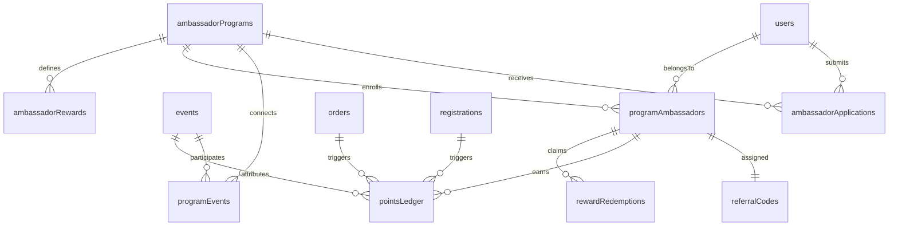
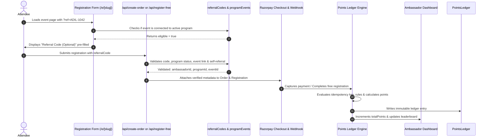

# TICKETLELO — CREATOR CAMPUS AMBASSADOR PROGRAM
## Comprehensive Architectural Blueprint & Engineering Design

### 1. Architectural Vision & Scope
The Creator Campus Ambassador Program transforms TicketLelo's legacy, per-event monetary commission module into a modern, multi-program, points-driven growth engine for campus creators and student leaders.

Key capabilities:
- **Organizer-Level Programs**: Organizers manage multiple independent ambassador programs across multiple events with complete lifecycle management (Draft, Published, Paused, Archived).
- **Many-to-Many Event Connections**: Programs connect to multiple events with granular referral toggles per event while retaining historical attribution.
- **Form Builder Integration**: Reuses TicketLelo's established form engine for custom ambassador applications with public submission workflows.
- **Multi-Role Compatibility**: An organizer or attendee can participate as an ambassador in programs without losing their organizer status, permissions, or creating duplicate accounts.
- **Cryptographic Referral Code Registry**: Concurrency-safe, globally unique `XXXX-NNNN` referral codes generated strictly post-approval.
- **Automated Event Field**: Event registration forms automatically show the optional referral field if and only if the event is connected to an active program.
- **Idempotent Points Ledger**: Append-only double-entry points ledger with automated awarding on paid & free registrations, refund reversals, and deterministic rule evaluation.
- **Strict Ambassador Privacy**: Ambassador dashboards display points, rank, and rewards — strictly prohibiting exposure of ticket revenue, raw attendee PII, or conversion rates.
- **Public & Embeddable Leaderboard**: Privacy-hardened leaderboards (overall or event-filtered) displaying only rank, display name, and points.
- **8-Category Reward Catalog**: Supports discounts, merchandise, goodies, vouchers, special access, and commissions with atomic redemptions.

---

### 2. Logical Data Architecture & Firestore Schemas

#### 2.1 Collection: `ambassadorPrograms`
| Field | Type | Description |
|---|---|---|
| `id` | String | Unique program ID (e.g. `prog_cc_1794456789`) |
| `organizerId` | String | UID of owning organizer (tenant isolation anchor) |
| `title` | String | Program title (e.g. "Campus Ambassador Cohort 2026") |
| `description` | String | Detailed program overview and expectations |
| `logo` | String | URL of program banner/logo |
| `applicationFormId` | String | ID in `forms` collection (targetType: "ambassador") |
| `applicationStartDate` | Timestamp | Date applications open |
| `applicationEndDate` | Timestamp | Date applications close |
| `status` | String | `"draft"` \| `"published"` \| `"paused"` \| `"archived"` |
| `referralSettings` | Object | Default points rules, allowed ticket types |
| `createdAt` | Timestamp | Initial creation timestamp |
| `updatedAt` | Timestamp | Last modification timestamp |
| `publishedAt` | Timestamp | Timestamp when published |

#### 2.2 Collection: `programEvents`
| Field | Type | Description |
|---|---|---|
| `id` | String | `${programId}_${eventId}` compound key |
| `programId` | String | Program ID |
| `eventId` | String | Connected TicketLelo event ID |
| `organizerId` | String | Owner of both program and event |
| `referralEnabled` | Boolean | Whether referral field appears on this event |
| `status` | String | `"connected"` \| `"disconnected"` |
| `connectedAt` | Timestamp | Association timestamp |
| `disconnectedAt` | Timestamp | Nullable disassociation timestamp |

#### 2.3 Collection: `ambassadorApplications`
| Field | Type | Description |
|---|---|---|
| `id` | String | Unique auto-generated application ID |
| `programId` | String | Associated program ID |
| `organizerId` | String | Associated organizer ID |
| `userId` | String | UID of applicant if authenticated; null if guest |
| `fullName` | String | Full name |
| `email` | String | Lowercase sanitized email |
| `whatsappPhone` | String | Clean numeric WhatsApp phone |
| `college` | String | College or university institution |
| `answers` | Object | Dynamic form submission answers |
| `status` | String | `"pending"` \| `"approved"` \| `"rejected"` \| `"withdrawn"` |
| `rejectionReason` | String | Optional feedback on rejection |
| `reviewedBy` | String | UID of organizer who reviewed |
| `reviewedAt` | Timestamp | Review timestamp |
| `createdAt` | Timestamp | Application submission timestamp |

#### 2.4 Collection: `programAmbassadors`
| Field | Type | Description |
|---|---|---|
| `id` | String | `${programId}_${userId}` or auto-id |
| `userId` | String | TicketLelo user UID |
| `programId` | String | Enrolled program ID |
| `applicationId` | String | Originating application ID |
| `organizerId` | String | Program organizer ID |
| `referralCode` | String | Active referral code (e.g. `ADIL-1042`) |
| `referralLink` | String | Direct referral URL (`/e/[slug]?ref=ADIL-1042`) |
| `status` | String | `"active"` \| `"suspended"` |
| `totalPoints` | Number | Integer accumulated points balance |
| `approvedAt` | Timestamp | Approval timestamp |
| `createdAt` | Timestamp | Profile creation timestamp |

#### 2.5 Collection: `referralCodes`
| Field | Type | Description |
|---|---|---|
| `id` | String | Normalized uppercase code (`ADIL-1042`), unique document ID |
| `code` | String | Display referral code |
| `ambassadorId` | String | Associated `programAmbassadors` ID |
| `userId` | String | Associated user UID |
| `programId` | String | Program ID |
| `organizerId` | String | Owning organizer ID |
| `status` | String | `"active"` \| `"inactive"` |
| `createdAt` | Timestamp | Generation timestamp |

#### 2.6 Collection: `pointsLedger`
| Field | Type | Description |
|---|---|---|
| `id` | String | Unique ledger ID or deterministic key |
| `idempotencyKey` | String | Unique deterministic key (`order_${orderId}_amb_${ambId}`) |
| `ambassadorId` | String | Ambassador profile ID |
| `userId` | String | Ambassador user UID |
| `programId` | String | Program ID |
| `eventId` | String | Attributed event ID |
| `registrationId` | String | Generated ticket/registration ID |
| `orderId` | String | Razorpay/TicketLelo order ID (or null for free) |
| `referralCode` | String | Code utilized at checkout |
| `ruleId` | String | Applied points rule ID |
| `ruleSnapshot` | Object | Immutable snapshot of rule at calculation time |
| `basePoints` | Number | Base points earned |
| `bonusPoints` | Number | Bonus points earned (milestone/time-based) |
| `totalPoints` | Number | Final integer points (positive for earn, negative for reversal) |
| `entryType` | String | `"earn"` \| `"reversal"` \| `"bonus"` \| `"adjustment"` |
| `reason` | String | Description of entry |
| `status` | String | `"completed"` \| `"reversed"` |
| `reversalRef` | String | Ledger entry ID being reversed (if applicable) |
| `adjustedBy` | String | UID of organizer/admin if manual adjustment |
| `createdAt` | Timestamp | Ledger write timestamp |

#### 2.7 Collection: `ambassadorRewards`
| Field | Type | Description |
|---|---|---|
| `id` | String | Reward ID |
| `programId` | String | Program ID |
| `organizerId` | String | Owning organizer ID |
| `title` | String | Reward title |
| `description` | String | Reward description |
| `rewardType` | String | `"fixed_discount"`, `"percentage_discount"`, `"merchandise"`, `"goodies"`, `"voucher"`, `"special_access"`, `"fixed_commission"`, `"percentage_commission"` |
| `thresholdPoints` | Number | Points required to claim/unlock |
| `inventory` | Number | Remaining inventory (-1 for unlimited) |
| `isActive` | Boolean | Availability toggle |
| `claimInstructions`| String | Instructions displayed post-redemption |
| `createdAt` | Timestamp | Creation timestamp |

#### 2.8 Collection: `rewardRedemptions`
| Field | Type | Description |
|---|---|---|
| `id` | String | Redemption ID |
| `rewardId` | String | Reward ID |
| `programId` | String | Program ID |
| `ambassadorId` | String | Ambassador profile ID |
| `userId` | String | Ambassador user UID |
| `pointsSpent` | Number | Integer points deducted |
| `status` | String | `"claimed"` \| `"fulfilled"` \| `"cancelled"` |
| `claimedAt` | Timestamp | Claim timestamp |
| `fulfilledAt` | Timestamp | Fulfillment timestamp |

---

### 3. End-to-End Referral Attribution Flow

---

### 4. Security & Tenant Isolation Guardrails
1. **Server-Side Privileged Operations**: All state mutations (program creation, application approval/rejection, points awarding, reward redemptions) execute through trusted Next.js API routes with session validation via `getAuthenticatedUser(request)` and Firebase Admin SDK.
2. **Owner-Scoped Firestore Rules**: Client reads and updates on `ambassadorPrograms`, `ambassadorApplications`, and `programAmbassadors` are strictly scoped to `request.auth.uid == resource.data.organizerId` or `request.auth.uid == resource.data.userId`.
3. **Write Protection on Points**: `pointsLedger` has `allow write: if false;` for client SDKs. All writes are exclusively handled by server-side Firebase Admin.
4. **Referral Integrity**: Arbitrary strings sent in client payloads are strictly validated against active program-event relations before attribution is recorded. Unverified codes are safely rejected without blocking attendee registration.
