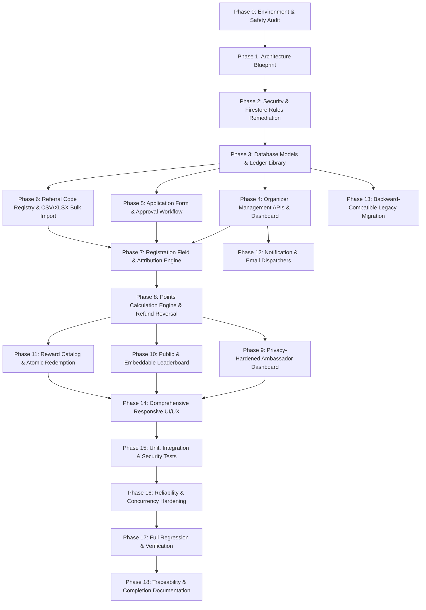

# TICKETLELO — CREATOR CAMPUS AMBASSADOR PROGRAM
## Phased Implementation Plan & Execution Milestones

### Phase Overview & Dependency Graph

### Detailed Phase Milestones

#### Milestone 1: Security Remediation & Tenant Isolation (Phase 2)
- Remediate `firestore.rules` to enforce `resource.data.organizerId == request.auth.uid`.
- Restrict `ambassadorPrograms`, `ambassadorApplications`, and `programAmbassadors` from cross-tenant access.
- Lock `pointsLedger` to server-only writes (`allow write: if isSuperAdmin()`).
- Prevent client self-approval on applications.

#### Milestone 2: Core Data Services & Unique Code Engine (Phase 3 & 6)
- Create `lib/creator-campus/programs.js`: CRUD and status transitions for programs and event connections.
- Create `lib/creator-campus/referral-registry.js`: `XXXX-NNNN` generator, collision detector, and transactional reservation in `referralCodes`.
- Implement `lib/creator-campus/points-engine.js`: Append-only points ledger, rule resolution, idempotency keys, and refund reversals.
- Build bulk CSV/XLSX importer with row validation, sanitization against formula injection, and error reporting.

#### Milestone 3: Server APIs & Backend Endpoints (Phase 4, 5, 8, 10, 11)
- Organizer APIs under `/api/organizer/programs/*`:
  - `route.js`: Program list & creation
  - `[programId]/route.js`: Program details & updates
  - `[programId]/status/route.js`: Status transitions
  - `[programId]/events/route.js`: Program-event connections
  - `[programId]/applications/route.js`: Application list & review
  - `[programId]/applications/[appId]/approve/route.js`: Server-side approval with code generation & notification
  - `[programId]/applications/[appId]/reject/route.js`: Server-side rejection with reason
  - `[programId]/referral-codes/route.js`: Referral code inventory
  - `[programId]/import/route.js`: Bulk import parser
  - `[programId]/points/rules/route.js`: Points rules configuration
  - `[programId]/points/ledger/route.js`: Audit points ledger
  - `[programId]/rewards/route.js`: Reward management
- Public & Ambassador APIs:
  - `/api/programs/[programId]/apply/route.js`: Public application
  - `/api/public/leaderboard/[programId]/route.js`: Privacy-hardened leaderboard
  - `/api/referral/validate/route.js`: Server-side referral code verification
  - `/api/ambassador/rewards/[rewardId]/claim/route.js`: Reward redemption

#### Milestone 4: End-to-End Registration & Payment Attribution (Phase 7 & 8)
- Dynamic registration form (`components/forms/dynamic-registration-form.jsx`):
  - Automatically queries event referral eligibility.
  - Renders canonical `Referral Code (Optional)` field with helper copy.
- `/api/create-order/route.js`:
  - Validates `referralCode` against active programs and approved ambassadors.
  - Enforces self-referral prevention.
  - Stores verified `referralAttribution` metadata on the order.
- `/api/register-free/route.js`:
  - Captures `referralCode`, validates, and writes attribution to registration document.
- `/api/verify-payment/route.js` & `/api/webhooks/razorpay/route.js`:
  - Hooks `awardPointsForRegistration` on payment capture.
  - Hooks `reversePointsForOrder` on refund/chargeback.

#### Milestone 5: Organizer & Ambassador UI Modules (Phase 4, 9, 10, 11, 14)
- Organizer Suite:
  - Add "Marketing & Growth" / "Campus Ambassadors" item to `components/layout/organiser-shell.jsx`.
  - Build organizer management pages at `src/app/(app)/admin/programs/`:
    - Programs List & Program Studio (Create/Edit)
    - Program Details with Tabbed View (Overview, Connected Events, Applications, Ambassadors, Codes, Points, Rewards, Leaderboard & Embeds, Settings)
    - Bulk Importer Modal & CSV Template Downloader
- Ambassador Dashboard (`src/app/(app)/(user)/ambassador/dashboard/page.jsx`):
  - Strip all prohibited fields (clicks, raw revenue, sales conversions).
  - Modernize with: Total Points, Current Rank, Points Summary, Referral Code, Share Link, QR Code, Points History, Rewards Catalog, and Leaderboard.
  - Multi-role switch button for organizers.
- Public Leaderboard & Embed:
  - Standalone embed route at `src/app/(app)/embed/leaderboard/[programId]/page.jsx`.
  - Public leaderboard page at `src/app/(app)/leaderboard/[programId]/page.jsx`.

#### Milestone 6: Test Suite & Documentation (Phase 15, 17, 18)
- Unit tests: Program lifecycle, code generation `XXXX-NNNN`, uniqueness, rule resolution, points calculation, refund reversal.
- Integration tests: Order checkout with referral, free registration with referral, bulk import parsing.
- Security tests: Cross-tenant isolation verification, self-approval prevention, client points write block.
- Verification and documentation update across all 7 audit reports.

