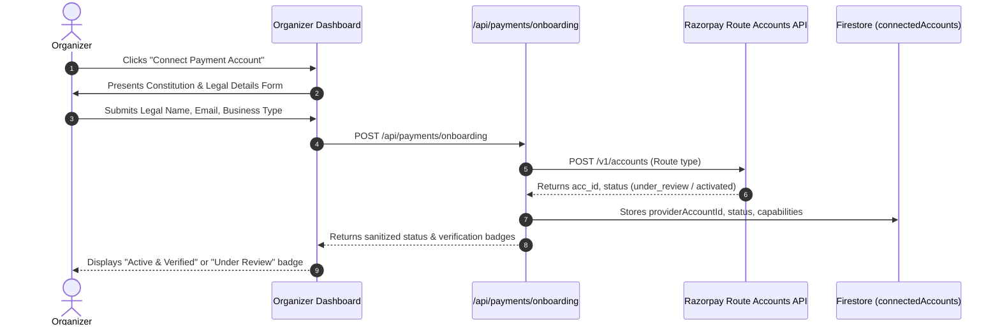

# TicketLelo Creator Connected-Account Onboarding

## 1. Onboarding Workflow
Event creators must connect and verify their payment provider account to publish paid events and receive automatic ticket revenue disbursements.

---

## 2. Supported Legal Business Types
The onboarding workflow maps creator entities to Razorpay-supported business types:
- `individual`: Sole proprietors, freelancers, independent artists
- `proprietorship`: Registered sole proprietorships
- `partnership`: Registered partnership firms
- `private_limited`: Private limited corporate entities
- `public_limited`: Public companies
- `llp`: Limited Liability Partnerships
- `ngo`: Registered trusts, societies, and section 8 non-profits

---

## 3. Account Status State Machine
TicketLelo tracks the onboarding lifecycle across the following canonical statuses:
- **`NOT_CONNECTED`**: Organizer has not initiated payment setup.
- **`ONBOARDING_PENDING`**: Account record created; external verification incomplete.
- **`KYC_PENDING`**: Provider has requested identity or bank verification documentation.
- **`UNDER_REVIEW`**: KYC submitted and currently undergoing compliance review by Razorpay.
- **`ACTIVE`**: Account fully verified. Settlements and transfers are active.
- **`RESTRICTED`**: Temporary operational hold placed by provider. Paid ticket sales halted.
- **`REJECTED`**: Provider rejected verification.
- **`SUSPENDED`**: Account blocked due to disputes or policy infractions.

---

## 4. Paid Event Gatekeeping Enforcement
In `lib/payments/connected-accounts.js`:
- **Free Events**: Always permitted regardless of onboarding status.
- **Paid Events**: When `RAZORPAY_ROUTE_ENABLED=true`, paid events enforce:
  `assertOrganizerPaidEventEligible(organizerId)`:
  - If status is not `ACTIVE`, server blocks event publishing and ticket checkout with code `ORGANIZER_PAYMENT_ACCOUNT_INELIGIBLE`.
  - Frontend checks are supplemented by strict server-side validation during `create-order` checkout.
