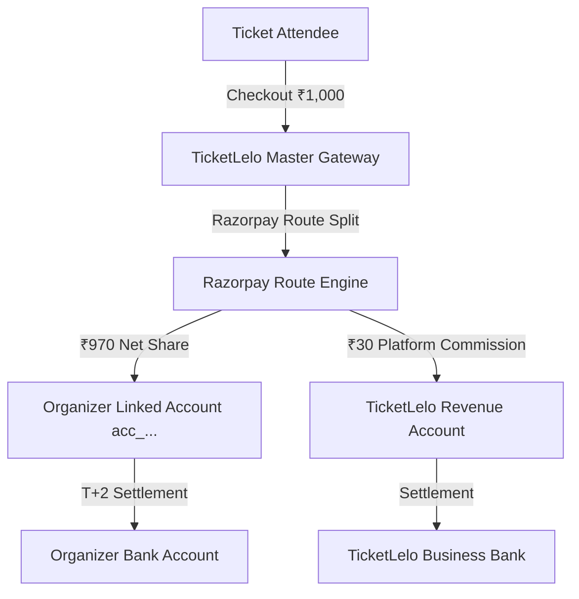
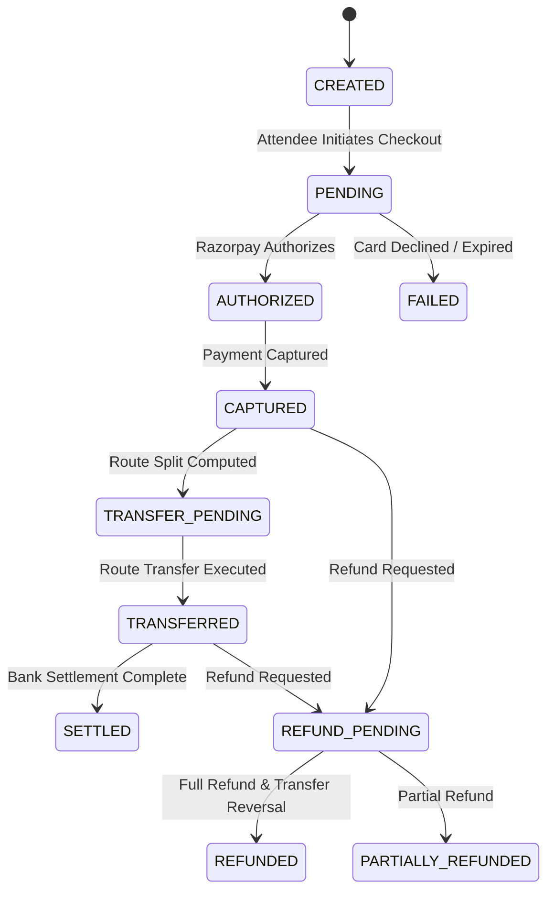

# TicketLelo Marketplace Payment Architecture

## 1. Overview & Core Business Model
TicketLelo operates as a modern event-ticketing marketplace connecting independent event organizers (colleges, creators, and community leaders) with event attendees.

Under the marketplace model:
1. Attendees purchase tickets on TicketLelo.
2. Payments are authorized and captured via TicketLelo's master payment gateway integration.
3. Razorpay Route automatically splits the gross payment:
   - **Organizer Share**: Transferred to the organizer's verified linked account (`acc_...`).
   - **TicketLelo Commission**: Retained in TicketLelo's account as marketplace revenue.
4. Organizers settle their proceeds directly through their linked account according to their bank schedule, with complete payer-payee transparency in compliance with Reserve Bank of India (RBI) Payment Aggregator guidelines.
5. TicketLelo maintains an immutable, double-entry financial ledger recording all gross inflows, organizer payables, platform commissions, taxes, gateway fees, refunds, and transfer reversals.



---

## 2. Layered Architecture

```
┌─────────────────────────────────────────────────────────────┐
│                 Organizer & Admin Dashboards                │
├─────────────────────────────────────────────────────────────┤
│         Checkout, Order APIs & Webhook Ingestion            │
├─────────────────────────────────────────────────────────────┤
│   Commission Engine   │   Ledger Engine   │  Refund Engine  │
├───────────────────────┴───────────────────┴─────────────────┤
│            Payment Provider Interface Abstraction           │
├───────────────────────────────┬─────────────────────────────┤
│     Razorpay Route Provider   │  Cashfree Split (Future)    │
├───────────────────────────────┴─────────────────────────────┤
│          Google Cloud Firestore (Database Storage)          │
└─────────────────────────────────────────────────────────────┘
```

### Layer Descriptions
1. **Provider Interface Layer (`lib/payments/provider-interface.js`)**:
   Defines the contract for payment operations:
   - `onboardCreator(params)`
   - `getConnectedAccount(accountId)`
   - `getAccountStatus(accountId)`
   - `createPaymentOrder(orderParams)`
   - `verifyPayment(verificationParams)`
   - `createTransferOrSplit(transferParams)`
   - `getTransferStatus(transferId)`
   - `refundPayment(refundParams)`
   - `reverseTransfer(reversalParams)`
   - `getSettlementStatus(settlementId)`
   - `reconcileTransaction(queryDate)`

2. **Razorpay Route Provider (`lib/payments/providers/razorpay-route.js`)**:
   Concrete implementation targeting Razorpay Linked Accounts and Route Transfer APIs. Feature-flagged via `RAZORPAY_ROUTE_ENABLED` and `RAZORPAY_ACCOUNT_ONBOARDING_ENABLED`.

3. **Commission Engine (`lib/payments/commission-engine.js`)**:
   Deterministic financial calculation engine operating strictly in integer paise. Resolves effective commissions with hierarchy:
   `Event Override > Organizer Override > Platform Default`.

4. **Connected Account Management (`lib/payments/connected-accounts.js`)**:
   Manages onboarding lifecycle:
   `NOT_CONNECTED -> ONBOARDING_PENDING -> UNDER_REVIEW -> ACTIVE (or RESTRICTED / REJECTED / SUSPENDED)`.

5. **Double-Entry Financial Ledger (`lib/payments/ledger.js`)**:
   Enforces debits equal credits for every financial event. Immutable audit trail.

6. **Refund & Reversal Engine (`lib/payments/refunds.js`)**:
   Coordinates attendee refunds, ledger adjustments, and Route transfer reversals (`reverse_all: 1`).

7. **Webhook Reliability Layer (`src/app/api/webhooks/razorpay/route.js`)**:
   Validates HMAC-SHA256 signatures, deduplicates via `webhookEvents`, and idempotently coordinates state machine transitions.

---

## 3. Database Schema Design (Firestore Collections)

### 3.1 `connectedAccounts`
```typescript
interface ConnectedAccount {
  id: string; // organizerId
  organizerId: string;
  provider: "razorpay_route" | "cashfree_split";
  providerAccountId: string; // e.g. "acc_QWE123456789"
  businessName: string;
  businessType: "individual" | "proprietorship" | "private_limited" | "educational_institution" | "partnership" | "other";
  contactName: string;
  contactEmail: string;
  contactPhone: string;
  onboardingStatus: "NOT_CONNECTED" | "ONBOARDING_PENDING" | "UNDER_REVIEW" | "ACTIVE" | "RESTRICTED" | "REJECTED" | "SUSPENDED";
  verificationStatus: "unverified" | "submitted" | "verified" | "rejected";
  accountCapabilities: {
    transfers: boolean;
    settlements: boolean;
  };
  settlementEligibility: boolean;
  metadata?: Record<string, any>;
  createdAt: Timestamp;
  updatedAt: Timestamp;
}
```

### 3.2 `marketplaceCommissions`
```typescript
interface CommissionConfiguration {
  id: string; // configId
  scope: "platform_default" | "organizer" | "event";
  organizerId?: string;
  eventId?: string;
  commissionType: "percentage" | "fixed" | "percentage_plus_fixed";
  percentageRate: number; // e.g. 3.0 for 3%
  fixedFeePaise: number; // e.g. 500 for ₹5.00
  currency: "INR";
  version: number;
  active: boolean;
  effectiveFrom: Timestamp;
  effectiveUntil?: Timestamp;
  createdAt: Timestamp;
}
```

### 3.3 `paymentSplits`
```typescript
interface PaymentSplit {
  id: string; // splitId
  orderId: string;
  paymentId: string;
  eventId: string;
  organizerId: string;
  connectedAccountId: string;
  grossAmountPaise: number;
  organizerAmountPaise: number;
  platformCommissionPaise: number;
  gatewayFeePaise: number;
  taxAmountPaise: number;
  transferStatus: "TRANSFER_PENDING" | "TRANSFERRED" | "FAILED" | "REVERSED" | "PARTIALLY_REVERSED";
  providerTransferId?: string; // trf_...
  transferredAt?: Timestamp;
  reversalId?: string;
  createdAt: Timestamp;
  updatedAt: Timestamp;
}
```

### 3.4 `ledgerEntries`
```typescript
interface LedgerEntry {
  id: string;
  transactionId: string; // paymentId, refundId, or transferId
  orderId: string;
  eventId: string;
  organizerId: string;
  account: "CASH_GATEWAY" | "ORGANIZER_PAYABLE" | "PLATFORM_COMMISSION" | "GATEWAY_FEES" | "TAXES_PAYABLE";
  entryType: "DEBIT" | "CREDIT";
  amountPaise: number;
  currency: "INR";
  reference: string;
  metadata?: Record<string, any>;
  createdAt: Timestamp;
}
```

### 3.5 `marketplaceRefunds`
```typescript
interface MarketplaceRefund {
  id: string; // refundId
  orderId: string;
  paymentId: string;
  amountPaise: number;
  refundType: "full" | "partial" | "event_cancellation";
  providerRefundId: string; // rfr_...
  providerTransferReversalId?: string; // rev_...
  refundStatus: "PENDING" | "PROCESSED" | "FAILED";
  reason: string;
  initiatedBy: string; // admin/organizer userId
  createdAt: Timestamp;
  updatedAt: Timestamp;
}
```

---

## 4. State Machine Transition Model



---

## 5. Security & Isolation Boundaries
1. **Server-Side Enforcement**: All payments, commissions, and transfers are calculated strictly server-side using Firebase Admin. Client-side amounts are rejected.
2. **Tenant Isolation**: An organizer can only access their own connected account, transaction history, and settlement figures.
3. **Double-Entry Ledger Balancing**: Every transaction verifies $\sum \text{Debits} == \sum \text{Credits}$ before committing to Firestore.
4. **Webhook Signature Cryptography**: Constant-time HMAC comparison prevents timing attacks and forged webhook deliveries.
