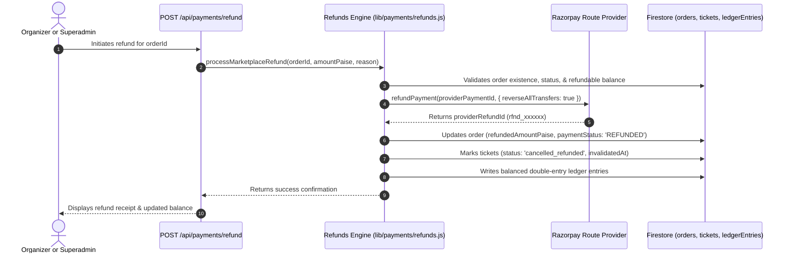

# TicketLelo Refund & Event Cancellation Flow

## 1. Overview
The TicketLelo refund engine (`lib/payments/refunds.js`) coordinates payment gateway refunds with Razorpay Route transfer reversals, ticket status updates, and double-entry ledger balancing.

---

## 2. Full Refund Sequence

---

## 3. Partial Refunds
- The engine validates that `targetRefundPaise <= (grossPaise - previouslyRefundedPaise)`.
- Calculates proportional deduction between organizer payable and platform commission.
- Invokes provider refund.
- Updates order `paymentStatus` to `PARTIALLY_REFUNDED`.
- Cumulative refund amounts are preserved to prevent over-refunding across multiple attempts.

---

## 4. Bulk Event Cancellation Processor
When an organizer or administrator cancels an event:
1. `processEventCancellationRefunds(eventId, reason)` queries all paid orders for the event.
2. Loops through each order and executes an automated refund with Route transfer reversal.
3. Automatically revokes all issued tickets in Firestore.
4. Returns batch metrics: `{ totalOrders, successfulRefunds, failedRefunds, errors }`.
